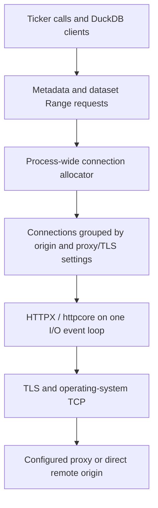

<!-- START doctoc generated TOC please keep comment here to allow auto update -->
<!-- DON'T EDIT THIS SECTION, INSTEAD RE-RUN doctoc TO UPDATE -->
**Table of Contents**  *generated with [DocToc](https://github.com/thlorenz/doctoc)*

- [HTTP connection pool](#http-connection-pool)
  - [What is shared](#what-is-shared)
  - [Connections, streams, and queries](#connections-streams-and-queries)
  - [Default policy](#default-policy)
  - [When a new connection is created](#when-a-new-connection-is-created)
  - [Idle connections and recovery](#idle-connections-and-recovery)
  - [Configuration and observation](#configuration-and-observation)
  - [Maintenance and validation](#maintenance-and-validation)

<!-- END doctoc generated TOC please keep comment here to allow auto update -->

# HTTP connection pool

DefeatBeta shares HTTP connections across Tickers and dataset files within one
Python process. Sequential calls reuse established connections; concurrent
calls share HTTP/2 streams and create more connections when existing capacity
is exhausted. The default policy works without application configuration.

This guide describes the current implementation. For data and footer reuse,
see [Local file cache](Local_File_Cache.md). For measurements and their network
conditions, see the [engineering report index](../../benchmark/reports/README.md).

## What is shared

An **origin** is a URL's scheme, hostname, and port. Different paths on
`https://huggingface.co:443` have the same origin. A resolved CDN hostname may
be a different origin. The number of origins depends on the URLs actually
resolved; it is not a fixed number of connections or one connection per file.

Connections can be reused when both the origin and the proxy/TLS trust settings
match. For example, direct access and access through a proxy use separate
connections. They still share one process-wide connection budget. Resolving a
CDN URL preserves the configured proxy policy.

Metadata requests, CDN resolution, and supported dataset Range requests use
the shared transport. Disabling disk caching, or falling back after a local
cache error, preserves this transport. Other DuckDB data sources can use their
own native readers and are outside this pool.



The synchronous Python API waits for results while the I/O loop lets requests
overlap during network waits. HTTPX, httpcore, and their dependencies implement
HTTP framing, TLS, flow control, and GOAWAY handling. DefeatBeta manages
allocation and coordinates receive notifications so a stream with decoded data
can resume without waiting for another stream's next socket read.

The pool and network connections are process-local. Separate Python processes
have separate budgets and sockets. Closing one Ticker's client does not close
connections still shared by other clients. Footer bytes and parsed indexes have
their own sharing rules, documented in the cache guide.

## Connections, streams, and queries

A **connection** is an established transport to an origin, directly or through
a proxy. An HTTP/2 **stream** carries one request/response exchange on that
connection. HTTP/1.1 connections have one scheduling slot in this implementation.

The allocator reserves a slot before dispatch and releases it when the response
is closed. Reservations include requests that have not sent headers yet and
responses still being consumed, so `reserved_streams` is not an exact count of
open streams on the wire.

For an established HTTP/2 connection, the effective scheduling limit is:

```text
min(peer stream limit, protocol-library limit, configured stream ceiling)
```

`max_streams_per_connection=None` removes only the extra client ceiling. The
peer and protocol limits still apply. Peer SETTINGS can change during a
connection's lifetime. If the limit decreases below current reservations,
existing responses finish and new admissions wait for capacity.

A Ticker query can require multiple HTTP requests, or none when its data is
cached. Therefore neither the physical connection budget nor the stream budget
is a limit on how many Ticker calls an application can submit concurrently.

## Default policy

| Setting | Default | Meaning |
| --- | ---: | --- |
| `core_connections_per_origin` | 4 | Best-effort idle retention per origin and proxy/TLS route after demand creates connections. |
| `max_connections_for_all_origins` | 16 | Total physical connection budget across all origins and routes in the process. |
| `max_streams_per_connection` | 4 | Client scheduling ceiling per HTTP/2 connection, also bounded by negotiated limits. |
| `max_connecting_per_origin` | 4 | Concurrent initializations per origin/route once protocol capacity is known. |
| `extra_connection_idle_timeout` | 60 seconds | Idle interval after which surplus connections become eligible for local retirement. |

Core size is a retention target: it does not preconnect four sockets or trigger
warmup requests. A sequential workload can keep reusing one connection. Under
load, one origin can grow beyond its core size if the global budget allows it.
Connecting, active, idle, draining, and closing connections all consume that
budget; capacity is returned only after closure finishes.

At the defaults, four ready HTTP/2 connections can hold up to 16 reservations.
Sixteen ready connections can hold up to 64 reservations in total, provided
every peer permits at least four streams. HTTP/1.1, lower peer limits, and
connections being established or closed reduce available capacity. Further
requests wait rather than creating unbounded sockets.

`Configuration.cache_fetch_workers` defaults to 16 concurrent extent-fetch
tasks per filesystem. This is a separate admission layer from HTTP scheduling;
it can limit the network demand a particular query workload produces.

The defaults balance reuse, concurrency, and bounded resource use. Measurements
support them for tested workloads, but do not establish a universal optimum or
guarantee that every network's bandwidth is saturated. DNS, handshakes, remote
service time, local reads, and query execution still contribute to latency.

## When a new connection is created

1. A request first tries to reserve capacity on an eligible established
   connection. Core connections are balanced by reservation-to-capacity ratio;
   surplus connections are used when core slots are unavailable.
2. If no slot is available, the allocator considers connecting sockets and
   queued demand. It creates a connection only when expected connecting capacity
   is insufficient and the global and per-origin initialization limits allow it.
3. The first connection for a new group initializes alone. Once its protocol
   capacity is known, queued demand can initialize additional connections in
   parallel. A connecting socket admits only its initial request until ready.
4. If reuse and expansion are unavailable, the request stays in the ordered
   allocation queue. Idle sockets from another group may be reclaimed to make
   room. Waiting is bounded by the request's pool timeout.

For example, if one established connection has four effective slots, requests
two through four can share it while earlier requests are downloading. A fifth
simultaneous request can trigger expansion if those slots remain occupied and
the other limits permit it. The allocator does not open a connection just to
reach the core target while an existing connection has capacity.

Waiting for remote data keeps the current reservation occupied, but does not
block other streams on the same HTTP/2 connection from being admitted. New
requests can use another connection once existing scheduling capacity is full.
An already transmitted request is not migrated to another connection merely
because its response is slow.

## Idle connections and recovery

Real requests naturally reuse eligible connections. DefeatBeta sends no
periodic HTTP heartbeat or HTTP/2 PING. OS TCP keepalive is enabled on direct
and proxy sockets with the operating system's timer defaults. TCP responsiveness
does not prevent a server from retiring its HTTP session.

An idle server closure or GOAWAY is discovered when the connection is used
again. The existing protocol stack classifies the connection, and the managed
transport performs bounded reassignment when safe. Dataset reads also have
bounded transport and expired-URL retries. Idle connections are not proactively
reopened just to maintain the core count.

Surplus idle connections are reclaimed locally after the configured interval;
the cleanup timer sends no network traffic. Core connections may also be
retired by the server or reclaimed to serve another origin under the global
budget. Active responses are not closed to shrink the idle pool.

## Configuration and observation

Applications can use the defaults directly. For explicit policy, configure once
before starting queries:

```python
from defeatbeta_api.client.http_pool import (
    configure_connection_pool,
    get_connection_pool_status,
)

configure_connection_pool(
    core_connections_per_origin=4,
    max_connections_for_all_origins=16,
    max_streams_per_connection=4,
    max_connecting_per_origin=4,
    extra_connection_idle_timeout=60,
)

status = get_connection_pool_status()
print(status["pending_requests"])
for connection in status["connections"]:
    print(connection["origin"], connection["state"],
          connection["reserved_streams"], connection["effective_stream_limit"])
```

Reconfiguration closes idle connections and rejects active or queued work.
See [Advanced Usage](Advanced_Usage.md#set-configuration) for all settings,
including per-filesystem workers and HTTP timeouts.

| Observation | Interpretation |
| --- | --- |
| `pending_requests` | Requests currently awaiting a connection reservation. |
| `reserved_streams` | Slots owned by requests on this connection. |
| `peer_stream_limit` | The observed HTTP/2 peer limit; absent for HTTP/1.1 or an unknown protocol. |
| `effective_stream_limit` | Capacity currently available to scheduling before subtracting reservations; zero for a connection that cannot admit work. |
| `state` | `connecting`, `ready`, `busy`, `draining`, or `closing`. `ready` may already have active requests; it is not an idle flag. |
| `pool_wait_seconds` | Accumulated acquisition time across requests, not remote-response time or a query's elapsed time. |
| `peak_connections`, `peak_reserved_streams` | Observed process peaks since initialization or reconfiguration. |

The snapshot is observational and does not open connections. A zero queue at one
instant does not rule out earlier waits. A request with a reservation may be
waiting for headers, body bytes, flow control, or local consumption; these are
distinct from waiting for pool admission. Status alone cannot reveal a server's
internal queue or unused network bandwidth.

## Maintenance and validation

Private protocol adapters are tested against pinned `httpx==0.28.1` and
`httpcore==1.0.9`. Dependency upgrades require the protocol, proxy, cancellation,
SETTINGS-change, and GOAWAY regressions in the [test guide](../../test/README.md).
The [benchmark guide](../../benchmark/README.md) separates reusable tools,
historical investigations, and explicitly published measurements.
