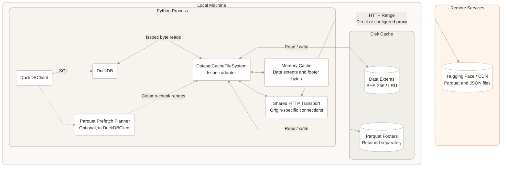

<!-- START doctoc generated TOC please keep comment here to allow auto update -->
<!-- DON'T EDIT THIS SECTION, INSTEAD RE-RUN doctoc TO UPDATE -->
**Table of Contents**  *generated with [DocToc](https://github.com/thlorenz/doctoc)*

- [Local file cache](#local-file-cache)
  - [Architecture](#architecture)
  - [What is stored](#what-is-stored)
  - [Location and lifetime](#location-and-lifetime)
  - [Network and queries](#network-and-queries)
  - [Configuration](#configuration)

<!-- END doctoc generated TOC please keep comment here to allow auto update -->

# Local file cache

DefeatBeta reads its Hugging Face dataset through a demand-driven HTTP Range
cache. DuckDB still queries the remote Parquet and JSON files; the cache stores
only bytes needed by actual reads, not complete copies of those files. The
cache is enabled by default and does not require users to select a layout.

## Architecture

The local cache stores variable-length extents instead of requiring complete
file downloads or fixed-size blocks. Cached bytes are keyed by the pinned
file and dataset version, so a new dataset version cannot reuse stale data.
Concurrent reads can share a pending download instead of issuing another
Range GET.

**Connection pool:** Metadata and dataset requests share process-wide HTTP
transports across Tickers and files. Effective proxy and TLS trust settings
select the transport; the shared allocator maintains origin-specific connections.
The default process-wide budget is 16 physical connections across all transports,
with four retained core connections per origin/route and four scheduling slots
per HTTP/2 connection, further bounded by negotiated protocol limits.
Connections grow on demand and idle surplus connections shrink after 60 seconds.
See [HTTP connection pool](HTTP_Connection_Pool.md) for sharing, stream capacity,
connection creation, idle recovery, configuration, and diagnostics. Closing one owner does not close
other owners' pools. Direct access and user-configured proxies are supported.
If a peer retires an idle HTTP session, the next business request recovers it;
there is no periodic HTTP heartbeat or HTTP/2 PING.

## What is stored

The cache stores validated, variable-length byte ranges (extents). Extents
follow the byte ranges needed by DuckDB and Parquet column chunks; they are
not aligned to a fixed 1 MiB grid. A simple symbol query uses Parquet
row-group statistics to prefetch candidate column chunks. Other queries can
still fetch their exact missing ranges on demand. Overlapping cached or
in-flight extents are reused instead of downloaded again.

The first query for a Parquet file prepares its footer and, with column
prefetch enabled, a simple symbol scan parses row-group metadata from that
footer. Validated footer bytes and immutable parsed metadata are shared across
Ticker and DuckDB client instances in the process. Concurrent preparation of
the same file/version coalesces into one download and one parse. The footer is
stored locally, with a per-file interprocess lock for shared directories. Reads
do not change its modification time. After process restart, the
metadata is parsed again from the local footer without downloading it again.
DuckDB uses a temporary metadata-only Parquet file for this parse; it is
removed immediately and is not part of the persistent cache.
File sizes come from the dataset spec when available. Other Parquet files are
prepared only when queried. No Parquet footer is downloaded merely because a
client starts.

Each cached range contains a SHA-256 digest and is published only after its
entire HTTP response has passed Range validation. A corrupt local range is
fetched again. Cache names are based on the pinned dataset file and the
dataset update version, not on the short-lived signed CDN URL.

## Location and lifetime

By default, cache files are kept flat in
`/tmp/defeatbeta/dataset-cache/<package-version>/` on macOS and Linux, or
`<system-temp>/defeatbeta/dataset-cache/<package-version>/` on Windows.
`Configuration(cache_directory=...)` can select another directory. The
project's previous `cache_httpfs` directory is separate and is not changed
by this cache.

When DefeatBeta detects a newer dataset update version, it stops reusing
bytes from the old version and removes stale cache-owned files. An occupied
file that Windows cannot remove is retried during later cleanup. Files not
recognized as cache-owned are left alone.

Each dataset query records the client's data generation before execution and
validates it after result materialization. If a concurrent query detects a
version or footer-metadata change, the affected query discards its result and
retries the whole query once. A second change raises `DatasetVersionChanged`
instead of returning mixed-generation results or retrying indefinitely.
Expired virtual file paths also reject further reads. The checks apply with
disk caching enabled or disabled and do not serialize SQL execution.

CDN address reuse also follows the dataset version and effective network route,
including when disk caching is disabled. An older in-flight resolution cannot
replace the current version's retained address. Clients consult the shared
resolution cache so they can reuse an address refreshed by another client.
Result publication and retirement of the corresponding in-flight build are
atomic, so a forced refresh cannot rejoin an already completed stale build.

Footer preparation keeps one persistent lock file per dataset URL in a cache
directory, independent of daily data versions. Contending processes wait for
the owner on all supported platforms; process termination releases the OS lock.
Lock files are retained, including any left by earlier implementations, because
another running process may still be using them.

The default 5 GiB disk limit applies to data extents. The least recently
used data extents are evicted when new data would exceed the limit. Memory
hits also count as recent use for this decision without writing a new file.
Footer extents are retained separately from the data-extent limit. No parsed
index or file-size JSON is persisted. The in-memory data tier is bounded
independently and can be disabled. Eviction only considers cache-owned data
extents in the active flat directory; unrelated files are never removed.
This limit can currently hold the published Parquet data set, but caching is
still on demand and a larger future data set may exceed the limit.

## Network and queries

The cache works with either direct access or a configured HTTP proxy. Shared
connections can serve different files and Tickers on the same origin, with
sequential reuse and concurrent HTTP/2 streams. There is no startup connection
warmup request. TCP keepalive uses OS socket options and timer defaults;
HTTPX/httpcore handles GOAWAY and replacement connections on demand, with
bounded request retries. If a local cache path fails during a query, DefeatBeta
retries supported dataset reads through the same shared HTTPX transport without
local caching. Disabling caching also preserves shared transport management.

`Ticker.download_data_performance()` reports cumulative data-cache and
connection-warmup counters separately. Automatic startup warmup is disabled,
so those counters remain zero unless an explicit diagnostic warms connections.
A warm query may increase cache hits
without increasing downloaded bytes. The benchmark's per-query deltas are
more appropriate when measuring one specific query.

## Configuration

Use `Configuration(cache_enabled=False)` to disable the project cache, or
set `cache_directory`, `cache_data_disk_limit_bytes`, `cache_data_memory_limit_bytes`, and
`cache_fetch_workers` to change its resource limits. The cache stores exact missing
byte ranges as variable-length extents, up to 16 MiB each; there is no public
block-size setting. The memory tier retains at most 64 extents within its byte
budget. `cache_prepare_footer_on_first_use=False`
disables explicit footer preparation for comparison experiments, but DuckDB
still reads the metadata required by a query. `cache_symbol_column_chunk_prefetch=False`
disables column-chunk prefetch for A/B experiments while preserving the
on-demand cache and footer preparation. See
[Advanced Usage](Advanced_Usage.md) for the complete configuration table.
